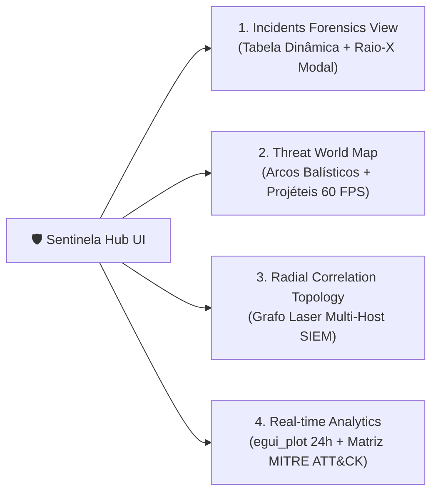

# 🛡️ Sentinela Hub

<div align="center">

[](https://www.rust-lang.org/)
[](https://github.com/emilk/egui)
[](LICENSE)
[](#-multi-theme-soc-engine)
[](https://www.sqlite.org/)
[](#-gui-showcase)
[](https://tokio.rs/)

**SIEM & Multi-Host Threat Correlation Center** — 100% Rust, Native Desktop GUI (`egui`/`eframe`), Embedded SQLite (`WAL`), Multi-Provider Webhook Dispatcher, Threat Intel IOC Engine, and Distributed Telemetry Ingestion.

[Visão Geral](#-visão-geral) • [GUI Showcase](#-gui-showcase) • [Funcionalidades SOC](#-funcionalidades-soc-avançadas) • [Arquitetura](#-arquitetura-do-sistema) • [Guia de Deployment](#-guia-de-deployment-distribuído) • [Referência de API](#-referência-da-api-rest) • [Instalação](#-instalação--compilação)

</div>

---

## 📖 Visão Geral

O **Sentinela Hub** é o centro de comando, agregação distribuída e correlação de ameaças em tempo real para agentes e sensores honeypot [Sentinela](https://github.com/teizinh/sentinela). Projetado especificamente para equipas de **SOC (*Security Operations Center*)**, **Blue Teams** e **laboratórios de segurança defensiva (*homelabs*)**, o hub consolida eventos de dezenas de nós distribuídos pela infraestrutura de rede, persiste telemetria com integridade forense através de SQLite embutido em modo WAL e **correlaciona ataques multi-host através de janelas temporais deslizantes**.

Construído 100% em **Rust puro** com o toolkit gráfico imediato `egui`/`eframe`, o Sentinela Hub elimina completamente o peso excessivo, consumo desmedido de RAM e latências típicas de plataformas baseadas em Electron, Chromium ou Node.js, entregando uma interface fluida a **60 FPS estáveis** com renderização acelerada por GPU.

```
┌────────────────────────────────────────────────────────────────────────────────────────┐
│  🛡️ SENTINELA HUB v0.1.0 SOC Multi-Host          🟢 [60 FPS | Ingestão: 0.0.0.0:8765] │
│  [🚨 Incidentes Globais]  [🗺️ Threat Map]  [⚡ Correlações (3)]  [📊 Métricas & Analytics] │
├────────────────────────────────────────────────────────────────────────────────────────┤
│  🖥️ 8 Agentes Online  │  ⚡ 1,248 Incidentes  │  ⚠️ 3 Campanhas Coordenadas Ativas     │
└────────────────────────────────────────────────────────────────────────────────────────┘
```

---

## 🖥️ GUI Showcase

O Sentinela Hub disponibiliza quatro vistas de comando tático dedicadas, permitindo aos analistas de segurança transitar entre análise forense detalhada de pacotes, monitorização geográfica mundial, deteção de campanhas distribuídas e telemetria analítica contínua.



---

### 1. Incidents Forensics View (`🚨 Incidentes Globais`)

Visualizador forense em tempo real de todos os incidentes recebidos dos nós da frota, com ordenação dinâmica, pesquisa com suporte a payload e modal de inspeção profunda.

```
┌──────────────────────────────────────────────────────────────────────────────────────────────────────────┐
│ 🔍 [ Pesquisar IP, porta, payload, nó...     ] ✖  Severidade: [TODAS] [CRÍTICO] [SWEEP] [MÉDIO] [SCAN]    │
├─────────────┬──────────────────┬─────────────┬──────────────┬────────────┬─────────────┬─────────────────┤
│ Data/Hora ↕ │ IP Origem ↕      │ Porto/Serv ↕│ Severidade   │ Ameaça ↕   │ Nó / Sensor │ Ações Forenses  │
├─────────────┼──────────────────┼─────────────┼──────────────┼────────────┼─────────────┼─────────────────┤
│ 18:42:01    │ 185.220.101.42   │ 22 / SSH    │ [ CRÍTICO ]  │ 95/100     │ vps-oracle  │ [🔬 Raio-X]     │
│ 18:41:55    │ 198.20.99.12     │ 445 / SMB   │ [ SWEEP ]    │ 65/100     │ nas-local   │ [🔬 Raio-X]     │
│ 18:40:12    │ 172.20.200.174   │ 80 / HTTP   │ [ MÉDIO ]    │ 40/100     │ laptop-dev  │ [🔬 Raio-X]     │
└─────────────┴──────────────────┴─────────────┴──────────────┴────────────┴─────────────┴─────────────────┘
```

- **Tabela Dinâmica Ordenável:** Ordenação interativa com um clique nos cabeçalhos (`Data/Hora`, `IP Origem`, `Porto/Serviço`, `Índice de Ameaça`) com indicadores direcionais ascendentes e descendentes (`▲`, `▼`, `↕`).
- **Live Payload Search & Multi-Filtro:** Motor de pesquisa instantâneo que filtra não apenas IP, porta, sensor e país, mas também o **conteúdo bruto do payload** (`payload.as_deref()`), localizando comandos como `/bin/sh`, tentativas de injeção SQL ou assinaturas de varrimento.
- **Pills de Severidade Tática:** Filtros rápidos coloridos com contornos estéticos (`CRÍTICO`, `SWEEP`, `MÉDIO`, `SCAN`, `ALERTA`).
- **🔬 Modal de Raio-X Forense (`Raio-X Modal`):**
  - **Hexdump Canónico Alinhado a 16 Bytes:** Renderização no padrão binário industrial:
    ```
    00000000  53 53 48 2d 32 2e 30 2d  4f 70 65 6e 53 53 48 5f  |SSH-2.0-OpenSSH_|
    00000010  39 2e 36 0d 0a                                    |9.6..           |
    ```
  - **Classificação Automática MITRE ATT&CK®:** Mapeamento em tempo real do tráfego para técnicas formais da matriz (ex: `T1110.001 Brute Force`, `T1046 Network Service Scanning`, `T1059 Command and Scripting Interpreter`, `T1486 Data Encrypted for Impact`, `T1071.004 DNS Tunneling`, `T1021.002 SMB Shares`).
  - **Metadados Completos:** País, cidade, ISP, rDNS (*Reverse DNS*), socket de rede e contagem de hits.
  - **Ações Imediatas de Resposta a Incidentes:**
    - Botão **`[ 🚫 Banir IP ]`**: Copia automaticamente para a área de transferência a regra pronta de firewall:
      ```bash
      sudo iptables -A INPUT -s 185.220.101.42 -j DROP
      ```
    - Botão **`[ 📋 Copiar JSON ]`**: Copia o payload estruturado em JSON com todos os metadados forenses para integração em relatórios.

---

### 2. Threat World Map (`🗺️ Threat Map`)

Visualizador geoespacial vetorial 2D procedimental que projeta ataques globais em tempo real sobre coordenadas equirretangulares, com trajetórias balísticas e partículas a 60 FPS.

```
┌────────────────────────────────────────────────────────────────────────────────────────┐
│ 🗺️ GLOBAL THREAT MAP                                          🟢 60 FPS Vetorial 100% Offline│
│                                                                                        │
│               (RU) 194.26.29.11 ──────╮                                                │
│                                       │ (Arco Balístico Bezier)                        │
│     (US) 198.20.99.12 ──╮             │                                                │
│                         │             ▼                                                │
│                         ╰───────► [ 🎯 PT Nó Lisboa ] (Radar Pulsante)                 │
│                                       ▲                                                │
│     (BR) 177.18.2.14 ─────────────────╯                                                │
│                                                                                        │
│  [HUD]: ⚡ 185.220.101.42 [TOR] -> vps-oracle (Porto: 22/SSH) | Lat: 39.50 Lon: -8.00  │
└────────────────────────────────────────────────────────────────────────────────────────┘
```

- **Renderização Procedimental 100% Offline:** Zero dependência de tiles online, chaves de API externas ou descarregamentos de internet. O mapa desenha linhas de costa continentais diretamente no canvas gráfico vetorial da `egui`.
- **Resolução Geoespacial Avançada (`COUNTRY_CENTROIDS` & `CITY_COORDINATES`):** Tabela de correspondência com mais de **65 centróides de países** e cidades globais de computação em nuvem (Frankfurt, Ashburn, Tokyo, London, Lisboa, Porto, etc.). Para IPs públicos não mapeados, utiliza *deterministic hash fallback* estável, garantindo renderização contínua sem ocorrência de valores `NaN`.
- **Detetor Especial RFC 1918 (LAN / Wi-Fi Privado):** Identifica gamas de rede interna (`10.0.0.0/8`, `172.16.0.0/12 - 172.31.0.0/12`, `192.168.0.0/16`, `127.0.0.0/8`) e posiciona-as em órbitas visuais ao redor do nó sensor visado com o indicador tático `[LAN/Wi-Fi]`.
- **Arcos Balísticos em Curvas de Bezier Quadráticas:** As trajetórias são calculadas via interpolação paramétrica $B(t) = (1-t)^2 P_0 + 2(1-t)t P_1 + t^2 P_2$, com amortecimento de altitude (`altitude damping`) para evitar cortes no topo do ecrã em ataques transcontinentais.
- **Projéteis Animados & Cauda de Velocidade:** Partículas ativas viajam ao longo da curva com feixes brilhantes coloridos pela severidade (`CRÍTICO` a vermelho vivo, `ALTO` a âmbar, `MÉDIO` a ciano).
- **Beacons de Sensores com Radar Pulsante:** Cada agente da rede é renderizado na sua posição geográfica com anéis concêntricos que pulsam periodicamente.
- **Painel Flutuante HUD (*Heads-Up Display*):** Monitor em tempo real no canto inferior com os últimos ataques em trânsito, coordenadas de origem/destino e atributos de ameaça.

---

### 3. Radial Correlation Topology (`⚡ Correlações`)

Módulo de inteligência SIEM que identifica campanhas de ataque multi-host coordenadas, visualizando atacantes que visam múltiplos agentes simultaneamente através de um layout de forças radial.

```
                          ┌──────────────────────────┐
                          │   Sensor 1: vps-oracle   │
                          │   Portos: 22 (SSH)       │
                          └─────────────▲────────────┘
                                        │
                                        │ Laser Vector
                                        │
┌──────────────────────────┐     ┌──────┴──────┐     ┌──────────────────────────┐
│   Sensor 2: nas-backup   ├─────┤ ⚡ ATACANTE ├─────┤  Sensor 3: fedora-laptop │
│   Portos: 445 (SMB)      │     │ 45.154.255.8│     │  Portos: 80, 8080 (HTTP) │
└──────────────────────────┘     │  [BOTNET]   │     └──────────────────────────┘
                                 └──────┬──────┘
                                        │
                                        │ Laser Vector
                                        │
                          ┌─────────────▼────────────┐
                          │   Sensor 4: dmz-gateway  │
                          │   Portos: 53 (DNS)       │
                          └──────────────────────────┘
```

- **Deteção de Ataques Coordenados (SIEM Multi-Host):** Agrupa incidentes em janelas temporais deslizantes (ex: 10 minutos). Se o mesmo endereço IP ou sub-rede atacar 2 ou mais sensores distintos, o motor correlaciona os eventos numa **Campanha Ativa**.
- **Grafo Radial com Vetores Laser:** O IP atacante é ancorado no centro geométrico do grafo com anéis de perigo concêntricos, enquanto vetores de feixe laser conectam o atacante a cada sensor Sentinela impactado.
- **Interatividade Total do Grafo:**
  - **Passagem do cursor (*Hover*):** Revela instantaneamente a telemetria do nó, serviços visados e contagem de conexões.
  - **Clique direto:** Copia o endereço IP do atacante com feedback sonoro e *toast notification*.
- **Cálculo Composto de Risco (*Threat Scoring*):**
  $$\text{Score Total} = \text{Score Base} + (\text{Nós Atingidos} \times 15) + \text{Bónus Threat Intel (Tor/C2/Botnet)}$$
- **Cards de Correlação com Alternância de Foco:** Permite alternar o foco do grafo radial com um clique entre diferentes campanhas maliciosas ativas.

---

### 4. Real-time Analytics Dashboard (`📊 Métricas & Analytics`)

Painel executivo e operacional construído sobre `egui_plot`, fornecendo telemetria temporal de 24 horas e quebra detalhada de táticas adversárias.

```
┌────────────────────────────────────────────────────────────────────────────────────────────────────────┐
│ 🎯 TOP ATACANTES GLOBAIS                       │ 📡 SERVIÇOS MAIS VISADOS                              │
│ 1. 185.220.101.42 • 84 hits • Perigo 95 (Tor)  │ SSH   ████████████████████████ 450 hits (45.0%)       │
│ 2. 45.154.255.8   • 62 hits • Perigo 90 (C2)   │ SMB   ████████████ 220 hits (22.0%)                   │
│ 3. 198.20.99.12   • 38 hits • Perigo 75 (Scan) │ HTTP  ████████ 150 hits (15.0%)                       │
├────────────────────────────────────────────────┴───────────────────────────────────────────────────────┤
│ 📈 TIMELINE DE ATIVIDADE HORÁRIA (24H) — Distribuição Temporal de Ataques                              │
│  Hits │                                  ▲                                                             │
│    80 │                                 ╱ ╲      ▲                                                     │
│    40 │                       ▲        ╱   ╲    ╱ ╲                                                    │
│    20 │        ▲             ╱ ╲  ▲   ╱     ╲  ╱   ╲                                                   │
│     0 └────────┴─────────────┴──┴─┴──┴───────┴┴─────┴─────────────────────────                         │
│       00:00        04:00        08:00        12:00        16:00        20:00        23:00              │
├────────────────────────────────────────────────────────────────────────────────────────────────────────┤
│ 🎯 MATRIZ MITRE ATT&CK® (TOP 5 TÉCNICAS ADVERSÁRIAS)                                                   │
│ [T1110.001] Brute Force: Password Guessing         ████████████████████████████ 420 hits (42.0%)       │
│ [T1046]     Network Service Scanning               ██████████████████ 270 hits (27.0%)                │
│ [T1059]     Command and Scripting Interpreter      ████████████ 180 hits (18.0%)                       │
│ [T1021.002] Remote Services: SMB Admin Shares      ████████ 120 hits (12.0%)                          │
│ [T1071.004] Application Layer Protocol: DNS        ████ 60 hits (6.0%)                                 │
└────────────────────────────────────────────────────────────────────────────────────────────────────────┘
```

- **Timeline Contínua em 24 Horas (`egui_plot`):** Gráfico de densidade temporal agrupado hora a hora (`00:00` a `23:00`). Suporta **arrasto com botão esquerdo**, **zoom com roda do rato** e pan interativo em eixos coordenados.
- **Top Atacantes Globais:** Tabela detalhada com classificação dos atacantes mais frequentes, contagem de ataques, severidade e etiquetas de proveniência de inteligência de ameaças.
- **Distribuição Percentual de Portos/Serviços:** Barras de progresso com cálculo percentual dinâmico do tráfego visado (SSH 22, SMB 445, HTTP 80, DNS 53, RDP 3389, Telnet 23).
- **Matriz de Ameaças MITRE ATT&CK®:** Agregação contínua das técnicas mais comuns com badges de código identificador e barras de progresso cromáticas individuais.

---

## ⚙️ Funcionalidades SOC Avançadas

### 🎨 Multi-Theme SOC Engine
O Sentinela Hub integra um motor nativo de temas projetado para diferentes ambientes de iluminação e preferências operacionais em salas de comando SOC. A alternância é feita instantaneamente através do botão **`[ 🎨 Tema ]`** no cabeçalho superior:

| Tema | Paleta Principal | Descrição Operacional |
| :--- | :--- | :--- |
| **`CyberSlate`** *(Default)* | Fundo Ardósia `#0D1117`, Ciano `#38BDF8`, Esmeralda `#34D399` | Contraste balanceado projetado para longas sessões de análise e investigação diurna/noturna. |
| **`MatrixGreen`** | Fundo Obsidiana `#050805`, Fósforo `#00FF66`, Verde Escuro `#0D2818` | Estilo retro-terminal de alta visibilidade militar com tipografia em tom fósforo monocromático. |
| **`CrimsonSoc`** | Fundo Tático `#0E0505`, Vermelho Rubi `#FF3344`, Borgonha `#2B0E11` | Modo de emergência e alta criticidade, ideal para salas de operações durante incidentes graves. |

### 🔔 Alertas Sonoros & Vinheta de Emergência
- **Terminal Bell Audio Alert (`\x07`):** Ao receber incidentes classificados com severidade `CRÍTICO`, o Hub emite imediatamente um alerta sonoro de sistema (sino de consola), avisando o operador mesmo com a janela em segundo plano.
- **Controlo de Áudio no Cabeçalho:** Botão rápido **`[ 🔔 Som: ON / OFF ]`** para ativar ou silenciar alertas a qualquer momento.
- **Emergency Alarm Vignette:** Vinheta perimetral em vermelho vivo que pulsa suavemente nas margens do ecrã a 60 FPS durante 4 segundos após a receção de um alerta crítico.

### 🌐 Webhook Alert Dispatcher
O Hub inclui um despachador assíncrono de notificações de segurança para múltiplos fornecedores com formatação nativa rica:

```
┌────────────────────────────────────────────────────────┐
│ 🚨 Alerta Sentinela SOC                                │
│ Incidente de segurança detetado no nó 'vps-oracle'     │
│                                                        │
│ • IP: 185.220.101.42       • Port/Service: 22/SSH      │
│ • Threat Score: 95/100     • MITRE: T1110.001          │
│ • Severidade: CRÍTICO      • País: Alemanha            │
└────────────────────────────────────────────────────────┘
```

- **Discord:** Embeds ricos com cores dinâmicas baseadas na ameaça (`#E74C3C` vermelho para crítico, `#F39C12` âmbar para médio), campos alinhados *inline* e código MITRE.
- **Slack:** Mensagens formatadas via **Slack Block Kit** com secções estruturadas e destaques em Markdown.
- **Telegram:** Mensagens instantâneas via MarkdownV2 com carateres de escape sanitizados e cabeçalhos em negrito.
- **Generic Webhook:** Formato JSON padronizado para ingestão em plataformas SIEM/SOAR corporativas (Wazuh, Splunk, Elastic, Cortex XSOAR).

### 🔍 Threat Intel IOC Enrichment
Classificador integrado em memória que inspeciona todos os endereços IP de origem contra feeds de indicadores de compromisso (IOCs):

- **Tor Exit Nodes (`[TOR]`):** Identifica nós de saída da rede anónima Tor (+25 pontos de bónus de ameaça).
- **C2 Command & Control (`[C2]`):** Deteta servidores de comando e controlo de malware conhecidos (+30 pontos de bónus).
- **Public Mass Scanners (`[SCANNER]`):** Reconhece motores de varrimento massivo da internet pública como **Shodan**, **Censys** e **Shadowserver** (+15 pontos de bónus).
- **Botnets Ativas (`[BOTNET]`):** Identifica redes ativas de botnets e propagadores de malware (+25 pontos de bónus).

### 📄 Relatório Executivo SOC
Com um único clique no botão **`[ 📄 Relatório SOC ]`**, o Sentinela Hub compila e exporta um dossiê completo em Markdown e JSON guardado em `~/.local/share/sentinela-hub/relatorio_soc.md` e copiado diretamente para a área de transferência do sistema operativo, contendo:
- Resumo de métricas da sessão (total de incidentes, nós ativos, campanhas correlacionadas).
- Tabela dos principais atacantes e países de origem.
- Mapeamento e distribuição de técnicas MITRE ATT&CK.
- Matriz de regras de remediação recomendadas (`iptables`, `nftables`).

---

## 🛡️ Arquitetura do Sistema

```
  ┌──────────────────────┐          ┌──────────────────────┐
  │   Sentinela Nó 1     │          │   Sentinela Nó 2     │
  │ (HP Laptop - Fedora) │          │ (VPS Oracle - Ubuntu)│
  └──────────┬───────────┘          └──────────┬───────────┘
             │                                 │
             │ HTTP POST /api/v1/incident      │
             └───────────────┬─────────────────┘
                             │
                             ▼
           ┌───────────────────────────────────┐
           │      SENTINELA HUB (:8765)        │
           │  ┌─────────────────────────────┐  │
           │  │ Tokio Async Ingestion Engine│  │
           │  └──────────────┬──────────────┘  │
           │                 │ Cross-thread    │
           │                 │ mpsc Channel    │
           │        ┌────────┴────────┐        │
           │        ▼                 ▼        │
           │  ┌───────────┐    ┌─────────────┐ │
           │  │  SQLite   │    │ Threat      │ │
           │  │ WAL Store │    │ Intel IOC   │ │
           │  └───────────┘    └──────┬──────┘ │
           │                          ▼        │
           │                   ┌─────────────┐ │
           │                   │ Correlation │ │
           │                   │   Engine    │ │
           │                   └──────┬──────┘ │
           │                          ▼        │
           │  ┌─────────────────────────────┐  │
           │  │  Native Desktop GUI (egui)  │  │
           │  │  60 FPS Cyber Multi-Theme   │  │
           │  └─────────────────────────────┘  │
           │                 │                 │
           │                 ▼                 │
           │  ┌─────────────────────────────┐  │
           │  │ Webhook Alert Dispatcher    │  │
           │  │ (Discord / Slack / Telegram)│  │
           │  └─────────────────────────────┘  │
           └───────────────────────────────────┘
```

### Componentes Internos
1. **Tokio Async Ingestion Engine (`src/server.rs`):** Servidor HTTP assíncrono ultrarrápido sem overhead de frameworks web pesados, processando centenas de requisições por segundo.
2. **Armazenamento Forense SQLite WAL (`src/db.rs`):** Base de dados embutida com *Write-Ahead Logging* (`PRAGMA journal_mode = WAL;`) e `PRAGMA synchronous = NORMAL;`, assegurando persistência duradoura com zero bloqueio nas consultas de leitura da interface gráfica.
3. **Motor de Correlação SIEM (`src/correlation.rs`):** Algoritmo de janela deslizante temporal que agrega incidentes multi-host por atacante, calculando scores de perigo e identificando alvos em comum.
4. **Enriquecimento IOC (`src/threat_intel.rs`):** Análise em memória de prefixos de rede com etiquetagem automática de categorias adversárias.
5. **Pipeline Gráfico 60 FPS (`src/ui/*`):** Interface nativa compilada com `eframe`/`egui`, com cache vetorial procedimental de continentes, cálculo balístico e renderização imediata.

---

## 🌐 Guia de Deployment Distribuído

O Sentinela Hub suporta tanto o modo de estação de trabalho de operações (Desktop GUI) como o modo servidor coletor dedicado para centros de dados ou VPS.

### 1. Modo GUI Desktop (SOC Workstation)
Arranque padrão para analistas que pretendem monitorizar a frota em direto no ecrã:

```bash
# Executa na porta padrão 8765
sentinela-hub

# Ou personalizando o IP de escuta e o caminho da base de dados SQLite
SENTINELA_HUB_ADDR="0.0.0.0:8765" SENTINELA_HUB_DB="/var/log/sentinela/hub.db" sentinela-hub
```

### 2. Modo Headless Collector (Servidor / VM / Sem Ecrã)
Para servidores centrais onde a interface gráfica não é necessária, o motor de ingestão assíncrono e a base de dados SQLite operam como serviço de fundo, permitindo que estações de trabalho acedam à mesma base de dados partilhada ou via API REST:

```bash
# Execução direta com base de dados persistente em servidor
SENTINELA_HUB_ADDR="192.168.1.100:8765" SENTINELA_HUB_DB="/opt/sentinela/hub.db" sentinela-hub
```

#### Exemplo de Serviço `systemd` (`/etc/systemd/system/sentinela-hub.service`)
```ini
[Unit]
Description=Sentinela Hub Security Ingestion & SIEM Engine
After=network.target

[Service]
Type=simple
User=sentinela
Group=sentinela
WorkingDirectory=/var/lib/sentinela-hub
Environment="SENTINELA_HUB_ADDR=0.0.0.0:8765"
Environment="SENTINELA_HUB_DB=/var/lib/sentinela-hub/sentinela_hub.db"
ExecStart=/usr/local/bin/sentinela-hub
Restart=always
RestartSec=5
LimitNOFILE=65535

[Install]
WantedBy=multi-user.target
```

Ativação do serviço:
```bash
sudo systemctl daemon-reload
sudo systemctl enable --now sentinela-hub
sudo systemctl status sentinela-hub
```

### 3. Ligação de Agentes Sentinela ao Hub
Em qualquer máquina Linux, servidor na cloud (Oracle, AWS, Hetzner, DigitalOcean) ou homelab, inicie o sensor [Sentinela](https://github.com/teizinh/sentinela) com o parâmetro `--hub`:

```bash
# Agente em produção no servidor web
sentinela --hub http://192.168.1.100:8765

# Agente com nó específico configurado
sentinela --hub http://10.0.0.5:8765 --node-id "srv-prod-web"

# Modo de simulação para demonstrações e testes de carga do SOC
sentinela --simulate --hub http://127.0.0.1:8765
```

---

## 🔌 Referência da API REST

O Sentinela Hub disponibiliza uma interface REST leve em formato JSON para ingestão de incidentes, registo de presença de nós (*heartbeats*) e sondas de saúde.

### Tabela de Endpoints

| Método | Endpoint | Alias v1 | Descrição | Código Sucesso |
| :--- | :--- | :--- | :--- | :--- |
| `GET` | `/api/health` | `/api/v1/health` | Verificação de estado, versão e disponibilidade do Hub | `200 OK` |
| `POST` | `/api/incidents` | `/api/v1/incident` | Registo de novos incidentes de segurança detetados | `200 OK` |
| `POST` | `/api/nodes` | `/api/v1/heartbeat`<br>`/api/v1/register` | Registo e atualização periódica de nós/sensores | `200 OK` |
| `GET` | `/api/correlations` | `/api/v1/correlations` | Consulta de campanhas multi-host ativas | `200 OK` |

---

### Especificação dos Endpoints & Payloads

#### 1. Sonda de Saúde (`GET /api/v1/health` ou `/api/health`)
Verifica se o servidor de ingestão do Hub está operacional.

**Exemplo de Pedido:**
```bash
curl -X GET http://127.0.0.1:8765/api/v1/health
```

**Resposta:**
```json
{
  "status": "healthy",
  "version": "0.1.0"
}
```

---

#### 2. Ingestão de Incidentes (`POST /api/v1/incident` ou `/api/incidents`)
Envia um evento de segurança registado por um sensor honeypot.

**Exemplo de Pedido:**
```bash
curl -X POST http://127.0.0.1:8765/api/v1/incident \
  -H "Content-Type: application/json" \
  -d '{
    "node_id": "vps-oracle-prod",
    "timestamp": "2026-11-13 18:42:01",
    "ip": "185.220.101.42",
    "port": 22,
    "service": "SSH",
    "severity": "CRÍTICO",
    "country": "Germany",
    "city": "Frankfurt",
    "isp": "Tor Exit Relay Network",
    "rdns": "tor-exit-42.example.org",
    "payload": "SSH-2.0-OpenSSH_9.6\\nroot /bin/bash",
    "threat_score": 90,
    "hit_count": 1
  }'
```

**Resposta:**
```json
{
  "status": "incident recorded"
}
```

> **Nota:** O endpoint também suporta payloads com empacotamento externo `{"node_id": "...", "incident": { ... }}` para máxima compatibilidade com diferentes versões de agentes.

---

#### 3. Heartbeat e Registo de Nós (`POST /api/v1/heartbeat` ou `/api/nodes`)
Regista um sensor Sentinela na frota do Hub ou atualiza o seu estado de *keepalive*.

**Exemplo de Pedido:**
```bash
curl -X POST http://127.0.0.1:8765/api/v1/heartbeat \
  -H "Content-Type: application/json" \
  -d '{
    "id": "vps-oracle-prod",
    "name": "Oracle Cloud Ubuntu WebNode",
    "ip": "194.26.29.11",
    "last_seen": "2026-11-13 18:42:00",
    "online": true,
    "services": ["SSH", "HTTP", "SMB"],
    "incident_count": 142
  }'
```

**Resposta:**
```json
{
  "status": "node updated"
}
```

---

## 🚀 Instalação & Compilação

### Pré-requisitos
- **Rust Toolchain:** Versão 1.75 ou superior (`rustup default stable`)
- **Compilador C / Linker:** `gcc` ou `clang` (para compilar a extensão bundled do SQLite)
- **Linux:** Suporta Wayland e X11 nativamente
- **Windows / macOS:** Totalmente compatível

### Compilação a partir do Código-Fonte
```bash
# Clonar o repositório
git clone https://github.com/teizinh/sentinela-hub.git
cd sentinela-hub

# Compilar em modo release com todas as otimizações
cargo build --release
```

O binário final fica disponível em `target/release/sentinela-hub`. Podes copiá-lo para a pasta de binários do teu utilizador:

```bash
cp target/release/sentinela-hub ~/.local/bin/
```

### Variáveis de Ambiente Suportadas

| Variável | Valor Padrão | Descrição |
| :--- | :--- | :--- |
| `SENTINELA_HUB_ADDR` | `0.0.0.0:8765` | Endereço IP e porto de escuta para o servidor de ingestão HTTP |
| `SENTINELA_HUB_DB` | `~/.local/share/sentinela-hub/sentinela_hub.db` | Caminho no sistema de ficheiros para a base de dados SQLite |

---

## 🧪 Testes Automatizados

O Sentinela Hub inclui um conjunto abrangente de testes unitários e de integração que cobrem o servidor de ingestão, parsing HTTP, enriquecimento de IOCs, mapeamento MITRE ATT&CK e motor de temas:

```bash
cargo test
```

---

## 🛠️ Tecnologias Utilizadas

- **Linguagem Principal:** [Rust 2021 Edition](https://www.rust-lang.org/)
- **GUI & Renderização:** [egui](https://github.com/emilk/egui) / [eframe](https://github.com/emilk/egui/tree/master/crates/eframe) 0.28
- **Plotting & Métricas:** [egui_plot](https://github.com/emilk/egui/tree/master/crates/egui_plot) 0.28
- **Runtime Assíncrono:** [Tokio](https://tokio.rs/) 1.0
- **Base de Dados Embutida:** [rusqlite](https://github.com/rusqlite/rusqlite) 0.31 (Bundled SQLite em modo WAL)
- **Serialização de Dados:** [Serde](https://serde.rs/) & [serde_json](https://github.com/serde-rs/json)
- **Tratamento Temporal:** [Chrono](https://github.com/chronotope/chrono)

---

## 📄 Licença

Distribuído sob a licença **MIT**. Consulta o ficheiro [LICENSE](LICENSE) para obter mais detalhes.

Desenvolvido com dedicação à segurança defensiva por **Salvador Teixeira Pontes** ([@teizinh](https://github.com/teizinh)).
